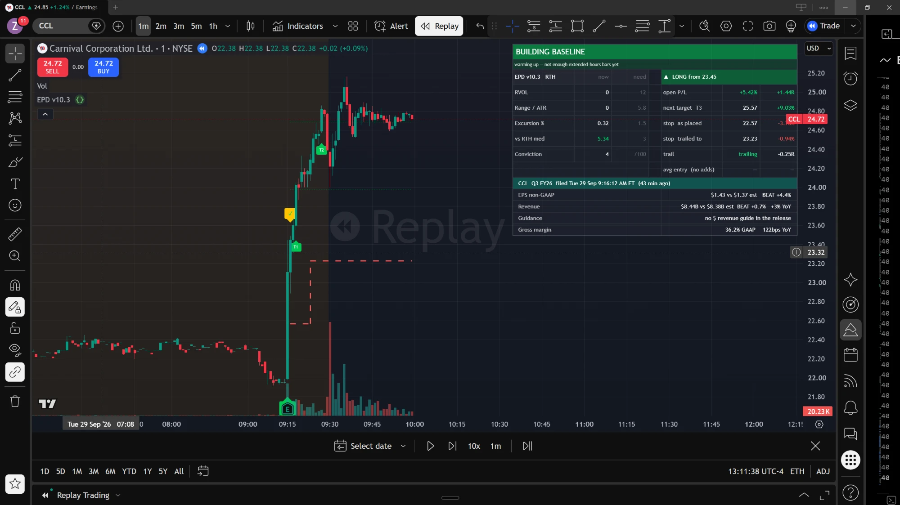
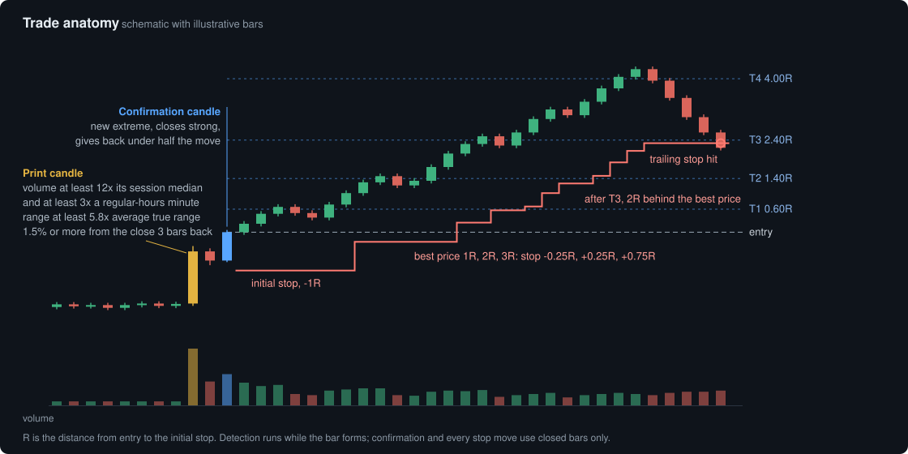
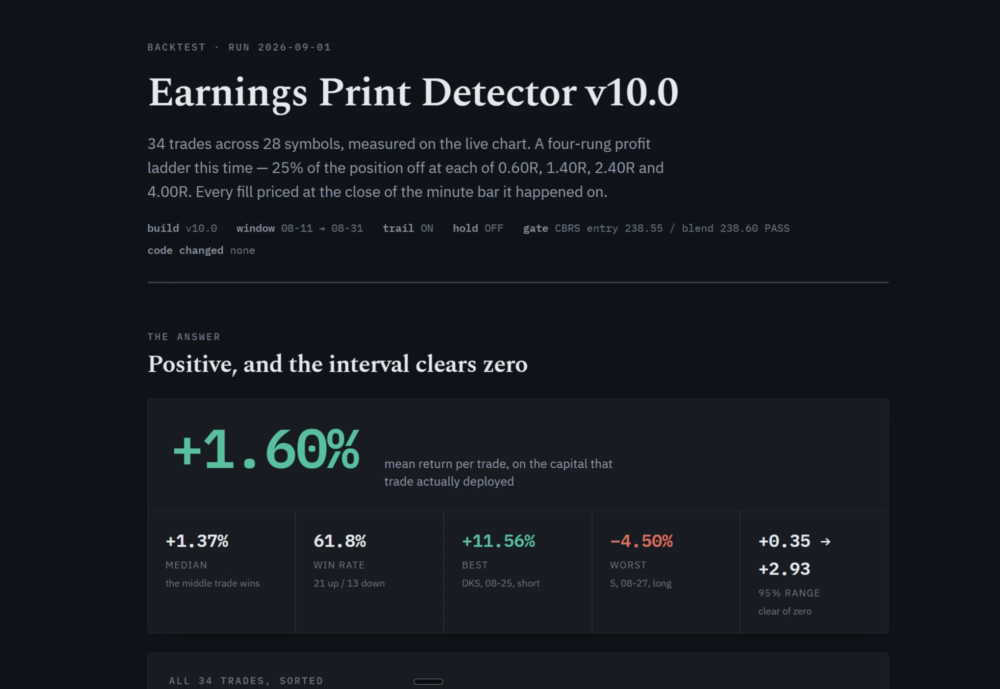
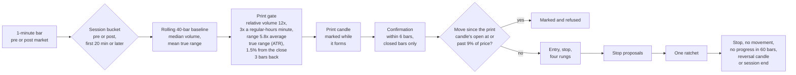

# Earnings Print Detector

A Pine Script v6 indicator for TradingView. It finds the one-minute candle where the market starts reacting to an earnings release (the print candle), waits for a separate confirmation candle, and then manages a trade plan whose stop steps up in stages and then trails the price. Python tools read the SEC filing behind the move and put the numbers on the chart. A second indicator scores three timeframes for scalping (trades held for seconds to minutes) and comes with a test harness built to try to prove its own signals wrong.





| Measured in this repository | |
|---|---|
| Earnings indicator, v10.3 | 3,861 lines of Pine Script v6 (4,070 at the source revision), 139 inputs, five of them marked inactive |
| Preserved milestones | 8 versions from v3.0 to v10.1 |
| Filing reader and watcher | 3,908 lines of Python across `earnings_read`, `earnings_watch`, `earnings-now` |
| Scalping indicator | 2,017 lines of Pine Script v6 |
| Scalping research package | 7,531 lines of Python in `scalping/src`, 210 tests |

Built by Zachary Adams by directing AI coding agents. Charting and indicator development started in 07/2026 and this indicator in 08/2026.

## Backtest results

Two measured runs on the live chart, each written up as a full report. Positions were priced from the indicator's own markers, with 25% taken off at each of four targets (0.60R, 1.40R, 2.40R and 4.00R) and every fill at the close of its one-minute bar. Returns are per trade, on the capital that trade deployed.

| Report | Build | Window | Trades | Mean per trade | 95% interval on the mean | Win rate |
|---|---|---|---|---|---|---|
| [August](https://claude.ai/artifact/FLG2NNmhR26iBwXKiEEmRa) | v10.0 | 11 to 31 August 2026 | 34 across 28 symbols | +1.60% | +0.35% to +2.93% | 61.8% |
| [September](https://claude.ai/artifact/1pazq181gKbX4ECz177kHE) | v10.2 | 1 to 29 September 2026 | 22 across 18 symbols | +0.83% | -0.79% to +2.63% | 59.1% |

The September run measured only companies that appeared in no earlier sample. Both reports test their headline against alternative fill conventions, dropped outliers and a ceiling set by the best exit each trade offered.



## Signal path



## Engineering problems

### Relative volume when normal volume is near zero

Extended-hours (pre-market and post-market) volume has no single baseline. The first minutes after the 16:00 close trade thousands of shares; two hours later a bar can trade none. One rolling average makes every post-close bar look extraordinary or hides a real print inside the session's own burst. The indicator keeps four independent baselines (pre-market and post-market, first 20 minutes and the rest), each a rolling 40-bar median of volume and mean of true range (ATR). True range is a bar's high-to-low range, widened to include any gap from the previous close. A bucket with fewer than 12 samples falls back to the pool of all four, which also needs 12 before anything fires. The 3x test against a regular-hours minute is skipped until a regular-hours baseline exists, and when extended-hours volume is under 2% of that baseline. [`SESSION AND BUCKET`, line 608](pine/earnings_print_detector.pine#L608)

### Live detection without repainting

A print has to be marked while its bar is still forming, and a marker that later disappears (repainting) is worse than none. Every live measurement uses the bar's high and low so far, so it can only grow as the minute develops. Confirmation and every stop move are restricted to closed bars. [`MEASUREMENTS`, line 883](pine/earnings_print_detector.pine#L883)

### The guard that threw away the answer

Skipping the first bar of a session removes a low-volume opening bar that is usually noise. When a company reports at the close, that first bar is the earnings candle, and the guard moved the print one bar later and anchored every later calculation to the wrong candle. The guard now yields when price action alone is overwhelming, a condition a low-volume bar cannot meet. [`FILTERS AND SIGNAL`, line 953](pine/earnings_print_detector.pine#L953)

### Many stop mechanisms, one ratchet

R is the distance from entry to the initial stop. The stop can be moved by a ladder, a trail behind the best price, a volatility-scaled trail and, in an optional mode, a recent swing high or low. Earlier versions let each one move and draw the stop, and whichever branch ran last won. Now each mechanism only proposes a level into `cand`; a single ratchet decides, and a single block draws. The volatility trail aims a multiple of current ATR behind price and closes up to half of the remaining gap per bar, so it tightens as overnight trading calms. When volatility returns, ATR rises and each step moves the stop less. It starts 45 bars after entry, never moves backward, and keeps at least 0.75R from price, a floor that decays to 0.45R over the next 120 bars. [`THE TRAIL`, line 2871](pine/earnings_print_detector.pine#L2871)

Targets T1 to T4 are drawn at 0.60R, 1.40R, 2.40R and 4.00R. The ladder steps on whole multiples of R:

| Best price reaches | Stop moves to |
|---|---|
| 1R | -0.25R |
| 2R | +0.25R |
| 3R | +0.75R |
| 4R | +1.25R |

Once T3 is reached, the stop also follows 2R behind the best price.

### A language with no network access

Pine cannot make HTTP requests. [`earnings-now.py`](tools/earnings-now.py) polls SEC EDGAR for an 8-K (the SEC's current-event filing) with Item 2.02 (results of operations), downloads the press release (exhibit EX-99.1), compares headline numbers with analyst consensus estimates from Finnhub when a key is set, and [`tv_push.py`](tools/tv_push.py) writes the result into the indicator's inputs through the Chrome DevTools port of the TradingView desktop app. Those inputs are declared last in the script so that adding them could not shift any saved setting.

### Results keyed to the right company and the right moment

[`earnings_watch.py`](tools/earnings_watch.py) runs two loops that do not block each other. The filing loop polls EDGAR about every 25 seconds and writes finished results. The chart loop runs every 2 seconds and renders the card for the symbol the chart is on, because an earlier build pushed whatever it had just found and put Marvell's numbers on a Palo Alto chart. Each card carries the moment the SEC accepted the filing, so in bar replay it stays hidden until the replay clock reaches that moment. [Replay-clock check, line 2755](pine/earnings_print_detector.pine#L2755). [`build_corpus.py`](tools/build_corpus.py) applies the same rule to the answer keys: it fetches the newest Item 2.02 8-K accepted on or before the key's date, so a company that has reported again is not scored against the wrong quarter.

### Press releases as adversarial input

[`earnings_read.py`](tools/earnings_read.py) turns a press release into EPS, revenue growth, margins and guidance. Its docstring lists the traps found by running it on real filings: the figure before its label, a neighbouring dollar amount that is not per share, "revenue backlog" read as revenue, and three-column income statements where the second number is last quarter. Every parser returns `None` when unsure. [`score_extraction.py`](tools/score_extraction.py) scores the parser against one of three [answer keys](backtest/) at a time. The keys were read from the filings independently of the parser and hold 106 entries for 104 distinct releases from 90 companies. The scorer separates missed fields from wrong ones, because a blank row is safe and a wrong row is not.

### Measurements that looked right and were wrong

[`backtest-harness.js`](tools/backtest-harness.js) runs inside the chart page and opens with four traps that each returned a convincing wrong number. One of them: an in-page symbol switch can fail silently and leave the previous ticker on screen, which produced clusters of symbols measured against the wrong data until identical bar counts gave it away. The harness asserts the exact symbol before and after loading history, and flags a run as not covered when history did not reach the date, so an empty result is not read as "no trade".

## Scalping indicator and null controls

[`three_timeframe_scalp.pine`](scalping/pine/three_timeframe_scalp.pine) scores 3-minute, 1-minute and 30-second evidence on one panel. The Python package in [`scalping/src/bot/scalp`](scalping/src/bot/scalp) derives features from the bars available at each moment, applies versioned decision rules and evaluates exits. The controls run on that Python rule pipeline.

[`controls.py`](scalping/src/bot/scalp/controls.py) runs three null controls that destroy the signal in different ways:

| Control | What it destroys | What it keeps |
|---|---|---|
| Shuffled bars | The price path inside each day | One bar per minute, ascending timestamps |
| Delayed signal | Timing | The real decisions on real bars |
| Random labels | Direction | Decision times and the long, short, wait mix |

One control had never tested anything. The first shuffle permuted whole bar objects, timestamps included. The bucket aggregator downstream assumes ascending time, so it discarded almost every 3-, 5- and 15-minute bucket. No confirmation could fire and the control made zero trades. Each earlier "passed the shuffled control" result was vacuous. The fix keeps the day's timestamps in order and permutes only the open, high, low, close and volume payloads. The docstring keeps the full account, and [`test_controls.py`](scalping/tests/scalp/test_controls.py) pins it.

## Local setup

```bash
# scalping package and its tests, offline
pip install -e "scalping[test]"
python -m pytest scalping/tests

# static checks for Pine sources: quoting, parentheses, input and plot counts
python tools/check.py pine/earnings_print_detector.pine

# replay a past release from EDGAR (set SEC_USER_AGENT to a name and contact first)
python tools/earnings-now.py --tickers MRVL --replay 2026-08-27
```

`tv_push.py` and the chart-reading scripts need `websockets`. The scripts in `scalping/scripts` expect a local SQLite file of bars, which is not published. The three `run_noise_boundary` scripts also append their results to a JSONL ledger. `score_extraction.py` scores against a corpus of press releases that `tools/build_corpus.py` downloads from EDGAR first. The trade files that the `backtest` scripts read are not published.

The package keeps bars, news, candidates and trade records in SQLite through [`store.py`](scalping/src/bot/data/store.py): 13 versioned migrations, 12 data tables and write-ahead logging. [`run_scalp_sweep.py`](scalping/scripts/run_scalp_sweep.py) appends every distinct configuration to an append-only [trial ledger](scalping/src/bot/backtest/trial_ledger.py) before it ranks anything, so a multiple-testing penalty such as the deflated Sharpe ratio counts every trial that was run.

To load an indicator, paste a `.pine` file into TradingView's Pine editor. The earnings indicator expects a one-minute chart with extended hours on.

## Repository map

| Path | Contents |
|---|---|
| `pine/earnings_print_detector.pine` | Current indicator, v10.3 |
| `pine/history` | Eight milestones, for reading the design as it grew |
| `tools` | EDGAR watcher, filing reader, chart bridge, Pine lint, chart harness |
| `backtest` | Rosters, answer keys, and analysis scripts that take exported trades as input |
| `scalping` | Three-timeframe indicator, research package, tests |

## Development loop

Charts were driven during development by the third-party [tradingview-mcp](https://github.com/tradesdontlie/tradingview-mcp) server (Model Context Protocol, a tool interface for agents), which lets an agent set symbols, compile Pine and read drawn labels. [`bt_driver.py`](tools/bt_driver.py) and [`tv_push.py`](tools/tv_push.py) use the same DevTools port directly.

Versions were kept as whole files so that any build could be restored with one paste. [`PROVENANCE.md`](PROVENANCE.md) lists the source revisions, exclusions and the meaning of `[n]` in code comments.
